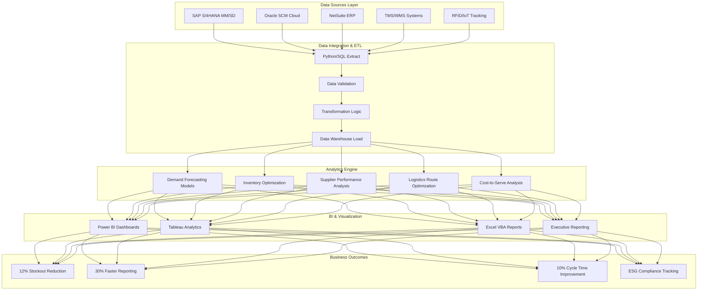
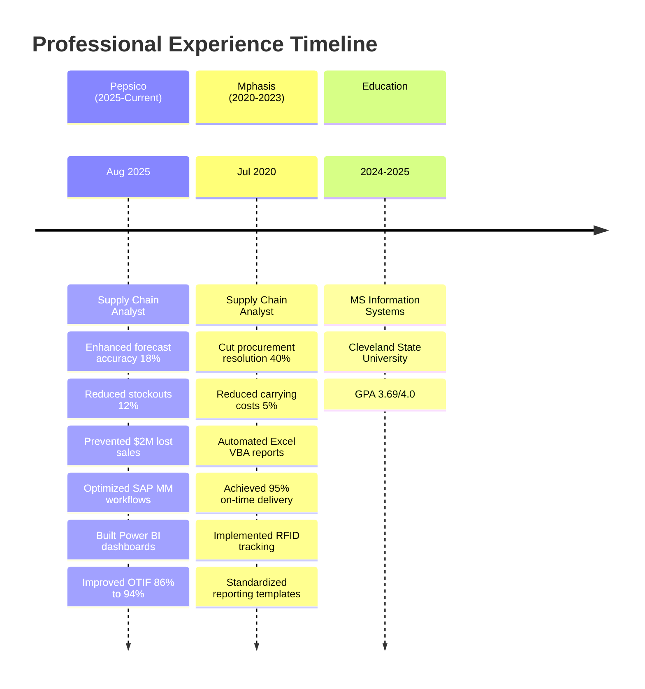

[%20971%203136-25D366?style=for-the-badge&logo=whatsapp&logoColor=white)](tel:+12169713136)

---

## 🎯 Professional Overview

Supply Chain Analyst with **4+ years of experience** driving measurable improvements in forecasting accuracy, procurement efficiency, and logistics optimization across global supply chain operations. Specialized in leveraging **data analytics**, **Python**, **SQL**, and **advanced BI tools** to deliver actionable insights that reduce costs, improve service levels, and enhance operational efficiency.

### 🏆 Key Achievements

<table>
<tr>
<td align="center" width="25%">
<h3>18%</h3>

Forecast Accuracy Improvement

</td>
<td align="center" width="25%">
<h3>$3.2M</h3>

Annual Carrying Cost Reduction

</td>
<td align="center" width="25%">
<h3>8%</h3>

Transportation Cost Decrease

</td>
<td align="center" width="25%">
<h3>94%</h3>

On-Time Delivery Achievement

</td>
</tr>
</table>

---

## 🏗️ Supply Chain Analytics Architecture

---

## 📊 Career Journey & Impact Timeline

---

## 💼 Professional Experience Deep Dive

### 🔹 **Pepsico** | Supply Chain Analyst | *Aug 2025 - Present*

**Impact Summary:** Transformed forecasting accuracy and procurement efficiency across North American distribution networks through advanced analytics and ERP optimization.

#### Key Deliverables & Technologies

**Demand Planning & Forecasting**
- Enhanced forecast accuracy by **18%** using SQL, Python, and R statistical modeling
- Reduced stockouts by **12%**, preventing **$2M in lost sales**
- Improved replenishment planning and production scheduling efficiency
- Technologies: Python (Pandas, NumPy), R, SQL, SAP MM

**ERP & Procurement Optimization**
- Directed SAP MM and procurement process enhancement projects
- Standardized purchase requisition and vendor management workflows
- Reduced manual processing efforts and improved PO cycle efficiency
- Technologies: SAP S/4HANA (MM/SD), Oracle SCM Cloud

**Business Intelligence & Reporting**
- Systematized SAP and Oracle SCM reporting into Power BI dashboards
- Reduced reporting time by **30%** while improving decision quality
- Created Tableau dashboards tracking fulfillment rates and supplier lead times
- Technologies: Power BI, Tableau, SQL, Python

**Logistics & Transportation**
- Decreased transportation costs **8% per quarter** through route optimization
- Optimized warehouse utilization using logistics analytics
- Shortened order cycle times by **10%**
- Technologies: TMS, Tableau, Excel Analytics

**Supplier Performance Management**
- Amplified supplier on-time delivery from **86% to 94%**
- Implemented compliance monitoring and procurement performance analytics
- Built supplier scorecards and performance dashboards
- Technologies: Power BI, SQL, Oracle SCM

**Sustainability & ESG Compliance**
- Built Tableau sustainability dashboards tracking carbon emissions and waste metrics
- Supported ESG compliance initiatives with waste reduction tracking
- Enhanced reporting accuracy for corporate compliance readiness
- Technologies: Tableau, SQL, Power BI

**Inventory Management**
- Enhanced inventory accuracy by integrating ERP and BI systems
- Lowered imbalances and improved stock availability significantly
- Implemented data validation and reconciliation processes
- Technologies: SAP, Oracle SCM, Power BI, Python

---

### 🔹 **Mphasis** | Supply Chain Analyst | *Jul 2020 - Dec 2023*

**Impact Summary:** Optimized procurement processes, reduced carrying costs, and improved supply chain visibility through automation and advanced analytics.

#### Key Achievements & Implementations

**Procurement Analytics & Resolution**
- Lessened procurement issue resolution time by **40%**
- Built SQL and Power BI dashboards monitoring vendor and logistics performance
- Streamlined vendor collaboration and invoice dispute resolution
- Technologies: SQL, Power BI, NetSuite, Oracle SCM

**Demand Planning & Material Availability**
- Escalated material availability by **10%**
- Supported NetSuite and Oracle SCM demand planning implementation
- Validated system configurations and data accuracy
- Technologies: NetSuite, Oracle SCM Cloud, SQL

**Inventory Optimization**
- Cut annual carrying costs by **5%** (**$3.2M savings**)
- Mechanized Excel VBA reports identifying excess and slow-moving inventory
- Designed contingency stock strategies for critical items
- Technologies: Excel VBA, SQL, Power BI

**Supplier & Logistics Management**
- Boosted vendor collaboration through improved communication workflows
- Ensured accurate compliance with contracts and payment terms
- Achieved **95% on-time delivery** coordination
- Technologies: SAP, NetSuite, TMS

**Reporting & Process Automation**
- Delivered consolidated procurement and logistics dashboards
- Increased transparency and reduced reporting turnaround by **25%**
- Lowered invoice mismatches by **15%** through data reconciliation
- Technologies: Power BI, SQL, Excel VBA

**Warehouse Technology Implementation**
- Minimized stock-outs by assisting RFID warehouse tracking pilot
- Enhanced real-time inventory visibility and accuracy
- Supported IoT tracking integration
- Technologies: RFID, WMS, IoT Tracking Systems

**Cross-Functional Collaboration**
- Heightened reporting accuracy by standardizing templates
- Supported procurement, logistics, and finance teams
- Enabled informed decision-making across multiple departments
- Technologies: Microsoft Office Suite, Power BI, SQL

---

## 🛠️ Comprehensive Technology Stack

### 📊 Data Analytics & Programming

### 🏢 Enterprise ERP & SCM Systems

### 📈 Business Intelligence & Visualization

![Power BI](https://img.shields.io/badge/Power_BI-F2C811?style=for-the-